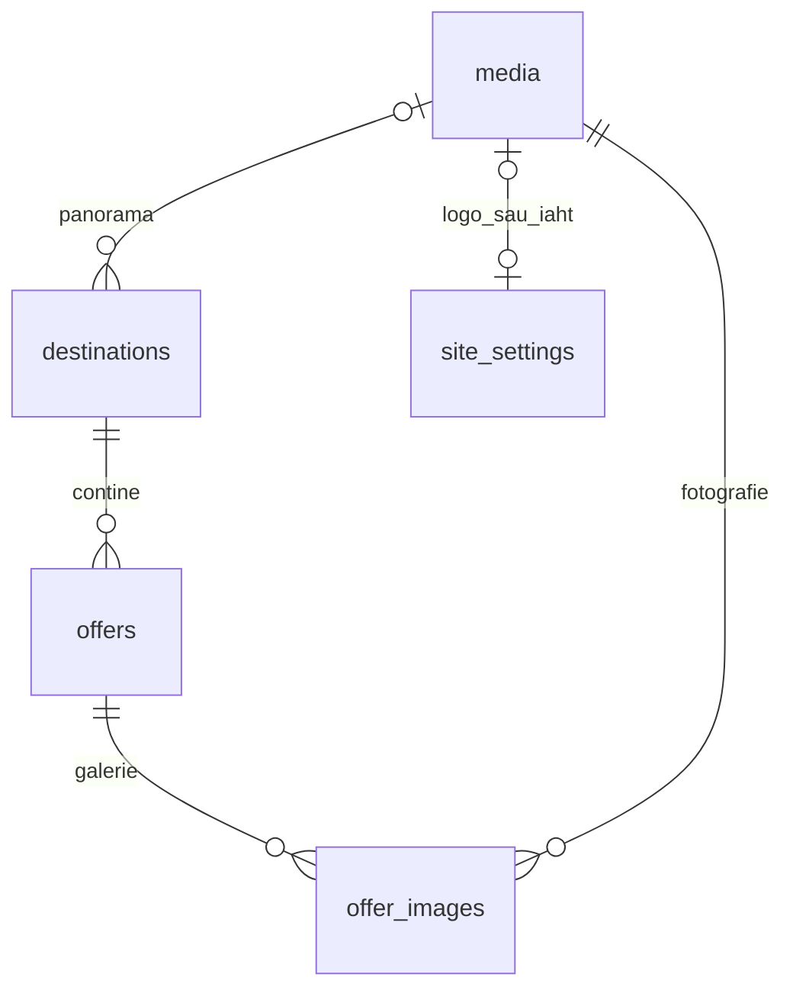

# Schema relațională

| Tabel | Rol și legături |
|---|---|
| destinations | Lefkada, Halkidiki, Thasos; panoramă și afișare |
| offers | N oferte pentru o destinație; type = accommodation / excursion / cruise / rental |
| offer_images | Leagă offers de media; sort_order stabilește coperta și ordinea |
| media | Metadatele fotografiilor; storage_path indică obiectul din Storage |
| site_settings | Un singur rând: texte, culori, logo, iaht, animație |
| private.admin_users | UUID-uri autorizate, legate de auth.users; inaccesibil direct prin API |

Închirierea are obligatoriu rental_kind = car sau atv. Același rând offers conține câmpurile comune tuturor tipurilor; CHECK-urile limitează dormitoarele la cazări și durata la excursii/croaziere. O ofertă are exact o destinație. Un fișier poate fi reutilizat în mai multe galerii.

Oferta este un element de catalog. O rezervare viitoare trebuie modelată separat, cu inventar/disponibilitate, reguli tarifare, client și status; nu se deduce din această schemă.
